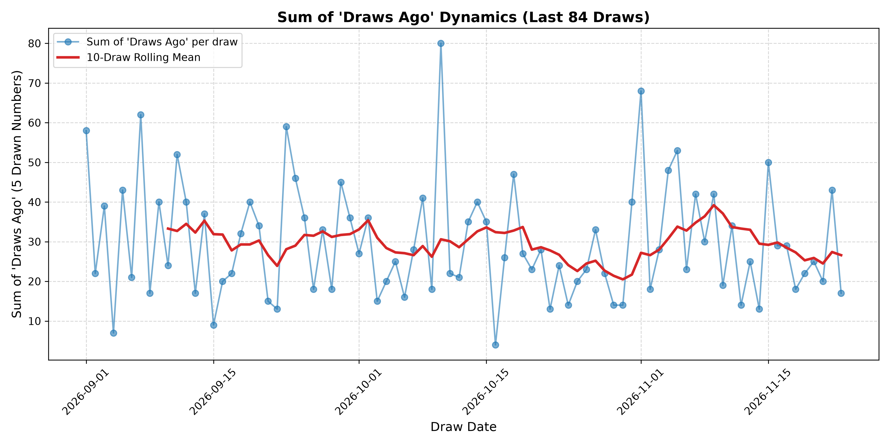

# Stochastic & Exploratory Lottery Data Analysis

Ongoing personal Python project exploring historical lottery draw data (`wyniki-pensja-sortowane.csv`) with a focus on data auditing, recency feature engineering (*"draws ago"*), descriptive statistics, mean/median centroid vector summaries, and rolling trend visualization.

## Key Features Implemented
- **Chronological Data Loading & Ordering:** Parses semicolon-delimited historical draw records, constructs draw dates, and sorts observations chronologically.
- **Leak-Free Recency Feature Engineering (*"Draws Ago"*):** Simulates historical state step-by-step—computing how many draws elapsed since a number's previous appearance *before* updating the state for the current draw.
- **Descriptive Statistics & Centroids:** Computes mean, median, standard deviation, min/max, quartiles (`Q1`, `Q3`), and sorted-position mean/median centroid vectors across recent draws (default window: last `84` draws).
- **Trend Visualization:** Generates a time-series plot comparing per-draw `"draws ago"` sums against a 10-draw rolling mean (`outputs/lottery_ds_trend.png`).

## Dataset & Source
- **Lottery Game:** Historical draw results from the Polish *Ekstra Pensja* lottery (`wyniki-pensja-sortowane.csv`).
- **Source Reference:** Historical draw data sourced/referenced from [Multipasko — Ekstra Pensja Results](https://www.multipasko.pl/wyniki-lotto/ekstra-pensja/).

## Sample Output Preview



## Project Structure

```text
lottery-analysis/
├── data/
│   └── wyniki-pensja-sortowane.csv
├── outputs/
│   └── lottery_ds_trend.png
├── src/
│   └── analyze_lottery_ds.py
├── requirements.txt
└── README.md
```

## Quick Start

```bash
python3 -m venv .venv
source .venv/bin/activate  # On Windows: .venv\Scripts\activate
pip install -r requirements.txt
python src/analyze_lottery_ds.py
```

## Roadmap & Next Steps
- **CLI & Configuration:** Add `argparse` support for configurable window sizes (`--last-n`), input/output paths, and statistical summary exports.
- **Modularization & Testing:** Split data loading, feature computation, summary metrics, and plotting into dedicated functions/modules with unit tests for edge cases (e.g., first appearance of a number, date ordering, missing values).
- **Statistical & ML Exploration:** Compare empirical distributions against null/uniform baselines, test additional temporal/lag features, and document findings in clean analytical notebooks or reports.